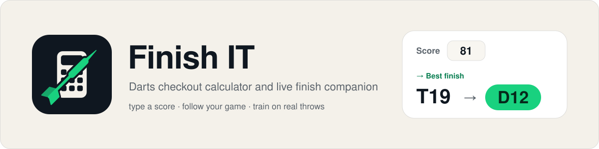
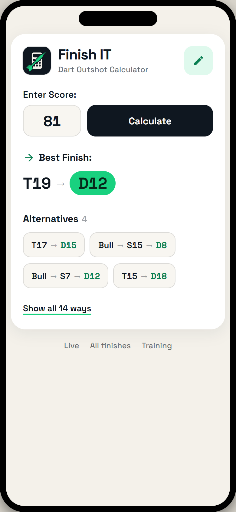
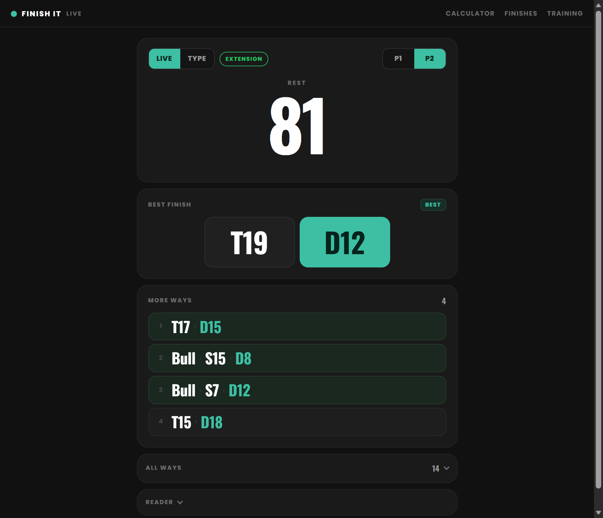
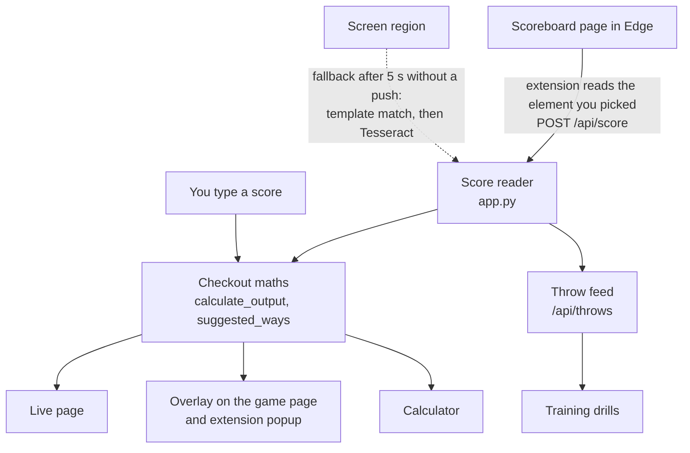
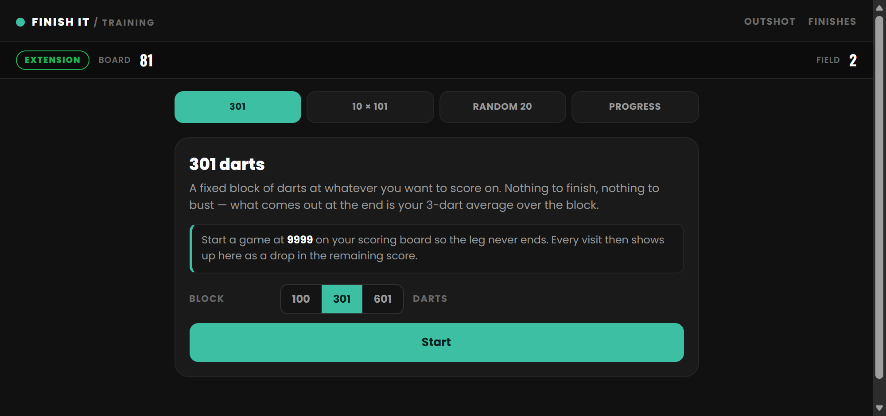

<p align="center">
  <picture>
    <source media="(prefers-color-scheme: dark)" srcset="docs/banner-dark.svg">
    
  </picture>
</p>

<p align="center">
  
  
  
  
  
  
</p>

<p align="center">
  <b>Type the score you have left and see how to finish it. Or let a small Edge extension follow the game in your browser and show the finish while you throw.</b><br>
  A Flask app on your own PC: no account, no cloud, and the extension runs only on the app and on the scoreboard sites you point it at.
</p>

<p align="center">
  <a href="#features">Features</a> ·
  <a href="#how-it-works">How it works</a> ·
  <a href="#quick-start">Quick start</a> ·
  <a href="#usage">Usage</a> ·
  <a href="#configuration">Configuration</a> ·
  <a href="docs/how-it-works.md">Full documentation</a>
</p>

<p align="center">
  <picture>
    <source media="(prefers-color-scheme: dark)" srcset="docs/calculator-dark.png">
    
  </picture>
  &nbsp;
  
  <br>
  <sub>Left: the calculator at 81, sized for a phone, light or dark with your system. Right: the live page while the extension follows a game; it shows the same finish for whoever is at the throw.</sub>
</p>

## Features

- **Calculator**: type any score from 2 to 170 and get the best route plus the alternatives. Every 1-, 2- and 3-dart finish that ends on a double is computed, and a hand-curated table puts the common routes first. Sized for a phone, light and dark, installable as an app.
- **Live finish**: the Edge extension reads the remaining score straight out of the scoreboard page you play on and sends it to the app, so the numbers are exact and need no OCR. The live page, a small overlay on the game page and the extension's popup all show the finish for the current score.
- **No site built in**: you show the extension the score once per site (**Select score element**, then a click on the number). It remembers the element and asks for access to that one site only. Use it only where the site's terms allow reading the page (see [Following a game](#following-a-game)).
- **Screen reading as a fallback**: without the extension, the app reads the score from a fixed region of the screen by template matching, with [Tesseract](https://github.com/tesseract-ocr/tesseract) as an optional second try.
- **Training drills**: 301 darts, 10 × 101 and Random 20, scored from the live feed while you throw. The history stays in a local file, with a progress chart and personal bests. Random 20 draws its numbers from professional match data.
- **All finishes, on screen and on paper**: `/finishes` lists every checkout from 2 to 170; [`checkouts_61-180.pdf`](checkouts_61-180.pdf) is a print-out of the preferred routes from 61 up, with the scores that have no checkout.
- **One file to hand out**: `python build_exe.py` builds `FinishIT.exe`. Double-click it and the live page opens.

## How it works



The app has three parts. The **reader** takes the score the extension pushes; when no push has arrived for five seconds it falls back to the screen. The **checkout maths** builds every legal finish for a score and orders it by the preferred-route table. The **throw feed** turns each drop in the remaining score into a numbered event, so the training page can poll it and never miss a throw. Everything runs on `127.0.0.1:5000`.

The reader pipeline, the outshot logic, the drills and the API are described in **[docs/how-it-works.md](docs/how-it-works.md)**.

## Quick start

You need Windows 10 or 11, Python 3.10 or later, and Microsoft Edge for the extension. The calculator alone runs anywhere Flask runs.

```powershell
git clone https://github.com/sguhring/-finish-it.git finish-it
cd finish-it
python -m venv venv
venv\Scripts\python -m pip install -r requirements.txt
venv\Scripts\python app.py
```

Open <http://127.0.0.1:5000> for the calculator and <http://127.0.0.1:5000/live> for the live page.

**The extension** (for following a game): open `edge://extensions`, switch on **Developer mode**, choose **Load unpacked** and pick the `edge-extension` folder. Then pin **Finish IT bridge** to the toolbar.

**Tesseract** is optional. Install it from [UB Mannheim](https://github.com/UB-Mannheim/tesseract/wiki) if you want the second OCR try; the app finds it in `C:\Program Files\Tesseract-OCR` or on your `PATH`.

**The exe**: `python build_exe.py` writes `dist\FinishIT.exe`, a single file with the pages and reference images inside. The extension is installed in Edge separately.

## Usage

### The calculator

Type a score and press **Calculate**. The best finish is on top with its double in green; the alternatives follow as chips, and **Show all ways** lists every route. `/?score=121` opens the page at a score.

### Following a game

> [!IMPORTANT]
> **Check the site's terms first.** The extension reads the score out of the scoreboard page in your own browser, and many online scoreboards and autoscoring systems forbid scraping or automated reading of their pages in their terms of use. Use it only on sites whose terms allow it, or with the provider's permission. It sends the score only to the app on your PC.

1. Start the app and open your scoreboard page in Edge.
2. Click the extension icon and press **Select score element**. Click player 1's score, then player 2's, or press **Enter** (or **Only one score**) when the page shows a single number. **Esc** cancels.
3. Allow the extension on that site when Edge asks. It then comes back on every visit without another pick.

From then on the remaining score reaches the app on every change. The popup shows where the score comes from (**extension** or **screen ocr**), what the pick reads, and a **Reset** that forgets the site. If the site changes its layout, the popup says **lost - select it again**.

On `/live`, **Live** follows the game and **Type** takes a score by hand; **P1** and **P2** choose whose score to show. The overlay on the game page has the same switch plus **AUTO**, which follows whoever is at the throw, and it can be folded, moved and resized.

### Training

Open `/training`. The drills read the score from the live feed, so there is nothing to type while you throw.

<p align="center">
  
</p>

| Drill | Start a game at | What it measures |
|---|---|---|
| **301 darts** | `9999` | Your 3-dart average over a fixed block of 100, 301 or 601 darts. No finish, no bust. |
| **10 × 101** | `101` | Darts per leg over ten legs, double out. A leg counts when the score reads 0. |
| **Random 20** | `9999` | Three different numbers each round, one dart at each; how many you hit, and your weakest numbers. |

A game at 9999 never ends, so every visit shows up as a drop in the remaining score. A visit that scores nothing does not move the score, so each drill has a **Nothing scored** button. Results go to `training_stats.json` next to the app, not to browser storage, so the history survives a cache clear. **Progress** charts each drill over time and marks personal bests.

## Configuration

| You want… | Do this |
|---|---|
| the calculator at a given score | open `/?score=121` |
| the extension on another scoreboard site | open the site, click the extension icon, **Select score element** |
| the extension to forget a site | **Reset** in the popup while you are on that site |
| the other player's finish | **P1** / **P2** on `/live` or in the overlay; **AUTO** in the overlay follows whoever is at the throw |
| screen reading on another screen or layout | change `OCR_FIELDS` in `app.py`, then check the frame with `python show_region.py` or the **Reader** fold on `/live` |
| screen reading for your scoreboard's font | capture your own reference images: `python capture_templates.py` (or `auto_capture.py`) |
| fewer misses, or fewer false matches | lower `TEMPLATE_CONF_THRESHOLD` in `app.py` (e.g. `0.50`), or raise it (e.g. `0.62`) |
| Tesseract from another folder | `{"tesseract_cmd": "D:/Tools/Tesseract-OCR/tesseract.exe"}` in `finishit.json` next to `app.py` or the exe |
| a different Random 20 draw | **Practice** (default), **Pro** or **Even** in the drill |
| a copy for a friend | `python build_exe.py`, then hand out `dist\FinishIT.exe` and the `edge-extension` folder |

`finishit.json` holds settings for one machine and is gitignored. Without it the app runs on defaults.

## Project structure

```text
app.py                 the Flask app: score reader, checkout maths, throw feed, API
build_exe.py           builds dist\FinishIT.exe with PyInstaller
requirements.txt       what the app and the build need
edge-extension/        the Edge extension: content.js (pick, read, push, overlay), popup, background
templates/             index.html (calculator), live.html, finishes.html, training.html
static/                icon master (icon.svg), exported PNG sizes, web manifest
templates_capture/     reference images for screen reading, one per score 0–501
capture_templates.py   capture your own reference images (live preview, keyboard controls)
auto_capture.py        the same, typing each score automatically
show_region.py         saves a screenshot of the region the reader captures
test_ocr.py            runs the reader on a saved image
test_training.js       runs the drill logic under node, no browser
train.py               experimental CNN trainer, not used by the app
checkouts_61-180.pdf   the printable checkout sheet (and its .html source)
docs/                  how-it-works.md, banner and screenshots
```

## Known limits

- **Screen reading is tuned to one setup**: `OCR_FIELDS` are pixel positions on one screen, and the reference images come from one scoreboard's font. On anything else, use the extension or capture your own images.
- **A pick can break**: when a site changes its page structure, the saved element is gone and you pick it again.
- **Site terms are your call**: the extension cannot know whether a scoreboard or autoscoring system allows its page to be read. Check the terms of use before you pick a score there.
- **Edge only tested**: the extension is Manifest V3 and has only been tried in Microsoft Edge on Windows.
- **Double out only**: the checkout maths covers double-out finishes from 2 to 170, not straight or master out.
- **The 9999 drills need the extension**: screen reading only knows scores up to 501, so 301 darts and Random 20 follow the game through the extension; 10 × 101 works either way.
- **Visits, not darts**: the board reports the remaining score, not single darts, so the drills count a visit as three darts and need **Nothing scored** for a visit that scored zero.
- **The CNN is an experiment**: `train.py` trains a classifier for the score images, but template matching does the job without a GPU and the app does not use it.

## Built with

[Flask](https://flask.palletsprojects.com) · [OpenCV](https://opencv.org) · [NumPy](https://numpy.org) · [python-mss](https://github.com/BoboTiG/python-mss) · [Tesseract](https://github.com/tesseract-ocr/tesseract) via pytesseract · [PyInstaller](https://pyinstaller.org) · Edge extension APIs (Manifest V3) · [Space Grotesk](https://fonts.google.com/specimen/Space+Grotesk)

Random 20 weights come from the dataset behind Haugh & Wang, *An Empirical Bayes Approach for Estimating Skill Models for Professional Darts Players* ([arXiv:2302.10750](https://arxiv.org/abs/2302.10750), data at [wangchunsem/OptimalDarts](https://github.com/wangchunsem/OptimalDarts)).

## License

[MIT](LICENSE)
